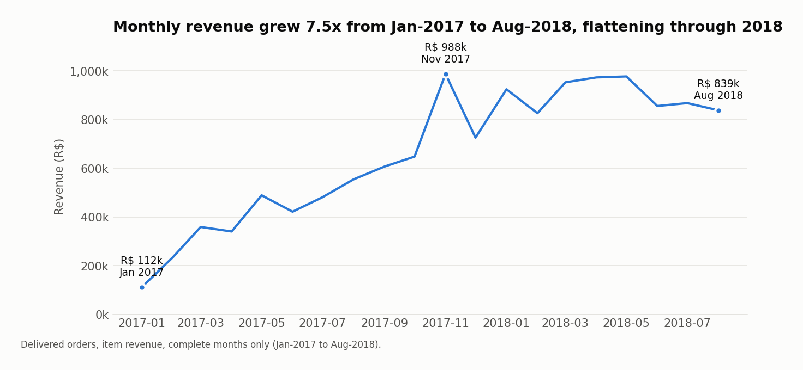
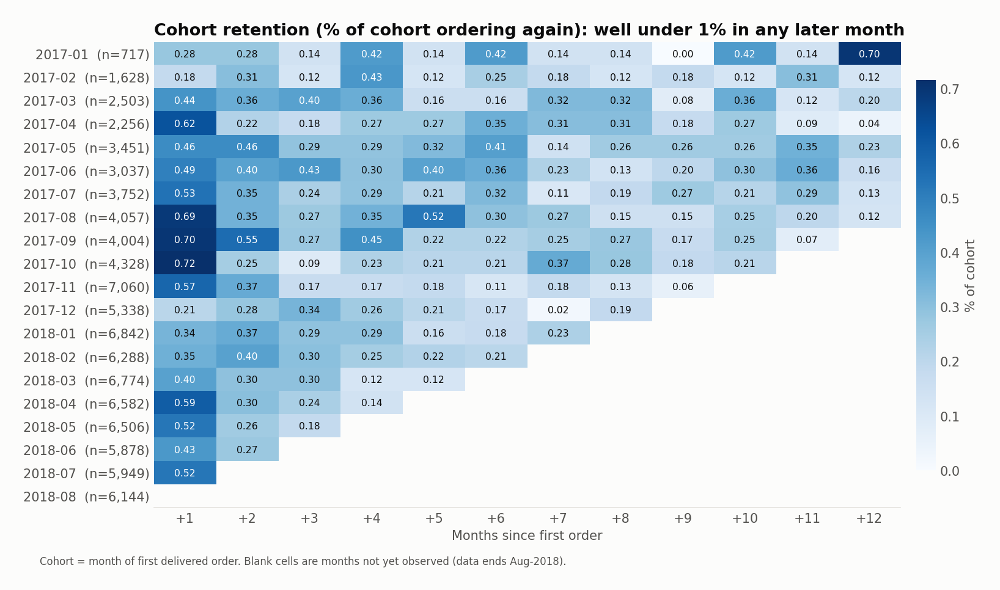
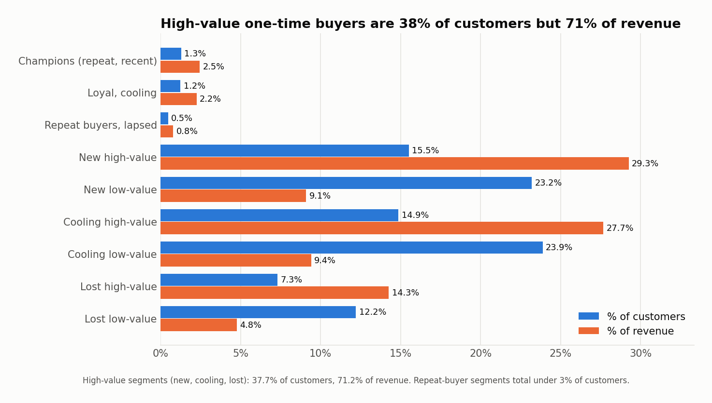
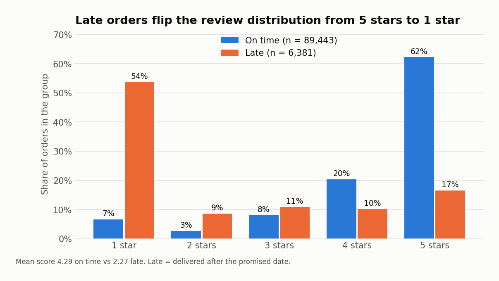
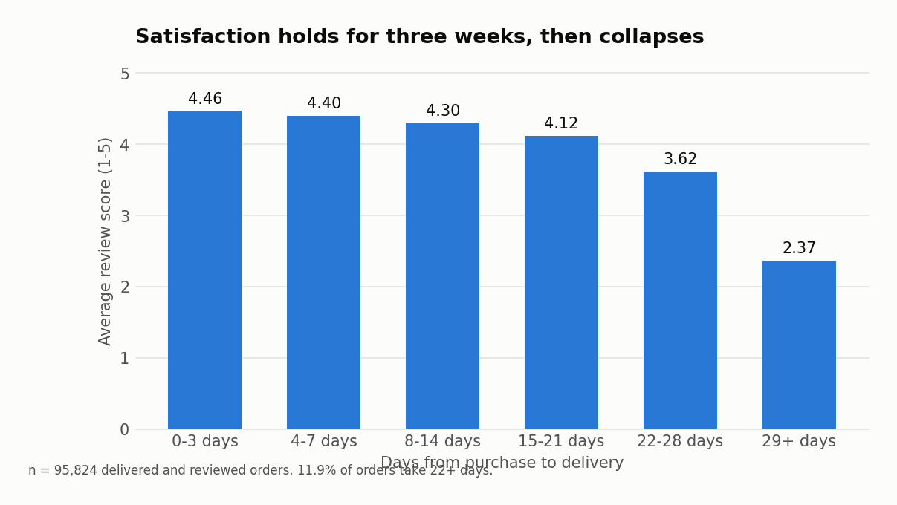
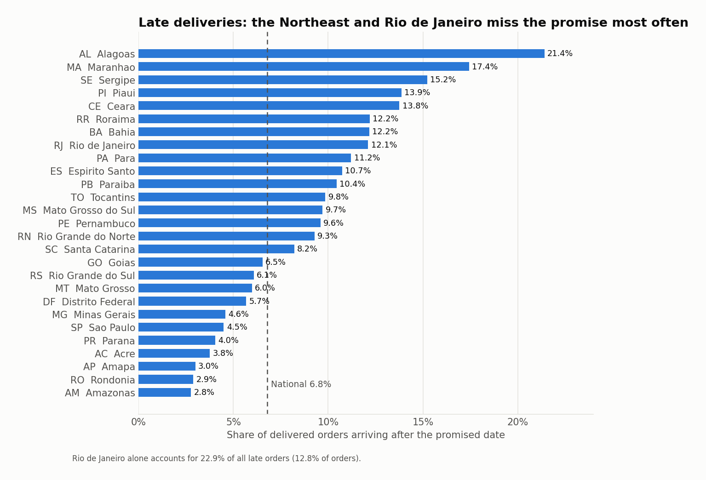
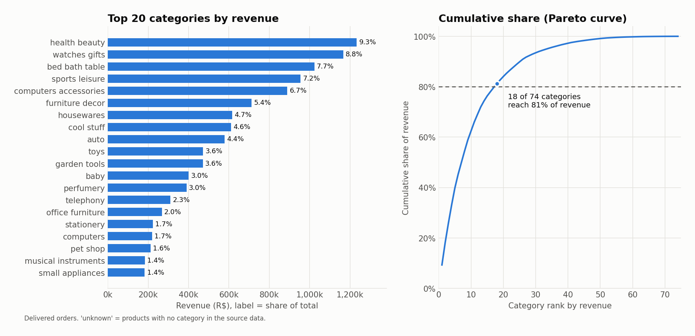
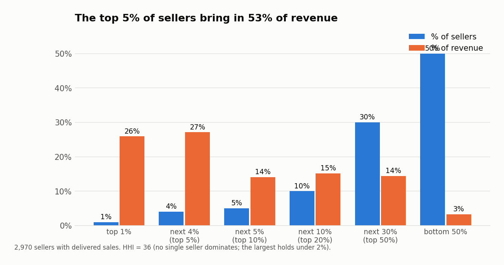
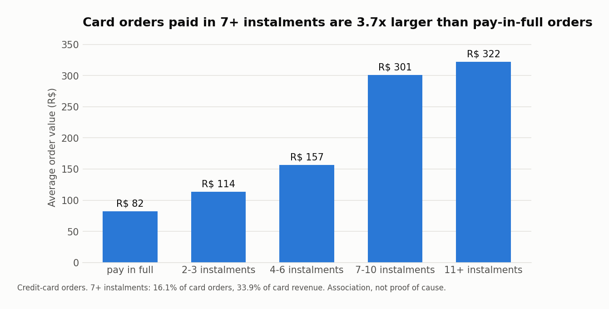

# Olist marketplace: what the data says and what to do about it

**Audience:** head of marketplace operations / growth.
**Data:** 99,441 orders placed on Olist (Brazil) between Sep-2016 and Oct-2018; 96,478 were
delivered, worth R$ 13.22M in item revenue from 93,358 customers and 2,970 active sellers.
**Definitions:** revenue = item price on delivered orders (freight excluded); late = delivered
after the promised date; repeat customer = 2+ delivered orders.
Every figure below is produced by `python run_all.py` (sources named under each finding).

## The short version

| | |
|---|---|
| Revenue (delivered) | R$ 13,221,498 |
| Delivered orders / AOV | 96,478 / R$ 137.04 |
| Repeat customer rate | 3.00% |
| Late delivery rate | 6.77% |
| Average review score | 4.156 / 5 |

Olist grew fast by acquiring new customers, but almost none of them come back, and growth
flattened in 2018. The clearest controllable drag on satisfaction is delivery: late orders
are rated 2 points lower. Fixing lateness in a few lanes and giving first-time buyers a
reason to return are the two highest-value moves.

---

## 1. Growth has flattened since the Nov-2017 peak

* Monthly revenue rose 7.5x, from R$ 112k (Jan-2017) to R$ 839k (Aug-2018).
* The peak is still Nov-2017 at R$ 988k (+52.4% on October, the Black Friday month).
  Every month of 2018 sits between R$ 826k and R$ 978k.
* Year-over-year growth is still positive but decelerating sharply: +727% in Jan-2018,
  +100% in May-2018, +51% in Aug-2018. Aug-2018 was down 3.4% on July.

**Why it matters:** the business has moved from hyper-growth to a plateau. Because it is
funded almost entirely by new customers (finding 2), a plateau in acquisition is a plateau
in revenue.

**Action:** stop reporting cumulative growth; track month-over-month revenue split into
new vs returning customers, and set a target for the returning share.

*Source: `sql/analysis/01_monthly_revenue_growth.sql`. Only complete months (Jan-2017 to
Aug-2018) are compared.*

## 2. 97% of customers never buy a second time

* Only 2,801 of 93,358 customers (3.00%) have more than one delivered order. They bring in
  5.5% of revenue.
* Across all monthly cohorts, 0.48% of customers order again in the month after their first
  purchase (420 of 86,950), 0.26% in month 3 and 0.17% in month 12.
* When customers do return, they do it quickly: the median gap to a second order is 29 days
  and 50.6% of second orders arrive within 30 days.
* A two-order customer is worth R$ 245 against R$ 138 for a one-order customer.

* RFM segmentation shows where the money is: high-value one-time buyers are 37.7% of
  customers but 71.2% of revenue. 6,837 of them ("Lost high-value", last order about 475
  days ago on average) account for R$ 1.89M.

**Why it matters:** every real of revenue has to be re-acquired. Lifting the repeat rate
from 3% to 4% would add roughly 930 returning customers at no acquisition cost.

**Action:** (a) run a post-purchase offer inside the 30-day window, when half of all
natural repeat purchases happen; (b) test a win-back campaign on the "Cooling high-value"
segment (13,887 customers, R$ 3.66M lifetime revenue) before they lapse; (c) report the
repeat rate monthly.

*Sources: `02_cohort_retention.sql`, `03_rfm_segmentation.sql`, `04_repeat_purchase_rate.sql`.
Caveat: a marketplace selling durable goods has structurally low repeat rates, and the data
covers only two years.*

## 3. A late delivery costs two review stars

* 6.77% of delivered orders (6,534) arrive after the promised date.
* On-time orders average 4.29 stars; late orders average 2.27. The difference is 2.02 stars
  (95% CI 1.98 to 2.06).
* 62.4% of late orders get a 1-2 star review, against 9.3% of on-time orders: a risk ratio
  of 6.7 (95% CI 6.55 to 6.93).
* Mann-Whitney U test: p < 1e-300; the probability that a random on-time order is rated
  higher than a random late one is 0.82 (rank-biserial correlation 0.64, a large effect).
* The result is unchanged when restricted to each customer's first order.

**Why it matters:** reviews are public and drive conversion for sellers. Late orders are
under 7% of volume but produce a disproportionate share of the 1-star reviews.

**Action:** treat "delivered by promised date" as a top-level KPI next to revenue, and
alert on it weekly. Late rate spiked to 12.4% in Nov-2017, 14.1% in Feb-2018 and 19.0% in
Mar-2018; the average review fell to 3.99, 3.88 and 3.81 in those same months.

*Source: `analysis/01_late_delivery_vs_reviews.py` (full output in
`outputs/stats/late_delivery_vs_reviews.md`). Observational data: association, not proof
that lateness alone causes the drop.*

## 4. Customers tolerate three weeks, not four

* Average review stays above 4.1 for anything delivered within 21 days (4.46 for 0-3 days,
  4.12 for 15-21 days).
* It drops to 3.62 for 22-28 days and 2.37 for 29+ days, where 59.8% of reviews are 1-2 stars.
* 12.0% of reviewed orders take 22 days or more.
* Olist promises conservatively: orders arrive on average 11.9 days before the promised date,
  and the average delivery takes 12.5 days (median 10).

**Why it matters:** the promise is generous, so an order that still misses it is very late
in absolute terms. Speed inside the first two weeks buys little extra satisfaction; avoiding
the 22+ day tail buys a lot.

**Action:** flag any order still undelivered at day 18 for proactive contact (status
message, voucher) before it becomes a 1-star review.

*Source: `sql/analysis/05_delivery_time_vs_review.sql`.*

## 5. Lateness is concentrated in specific lanes: Rio de Janeiro first

* By rate, the Northeast is worst: Alagoas 21.4%, Maranhao 17.4%, Sergipe 15.2%. The region
  as a whole is late 12.7% of the time and waits 19.9 days on average, against 10.7 days in
  the Southeast.
* By volume, Rio de Janeiro is the problem: a 12.1% late rate on 12.8% of all orders, which
  makes it 22.9% of every late order in the country. Sao Paulo, next door, is at 4.5%.
* Controlling for delivery speed and lateness, customers outside the Southeast are *less*
  likely to leave a low review (odds ratios 0.59 to 0.86). The lower raw scores in the North
  and Northeast are a logistics effect, not a tougher customer.

**Why it matters:** a national "improve delivery" programme is unfocused. One state explains
nearly a quarter of the problem and is next to the main seller base.

**Action:** review carrier performance on Sao Paulo to Rio de Janeiro lanes first; for the
Northeast, lengthen the promised date or add a regional fulfilment option, since the
transit itself is long.

*Sources: `06_late_delivery_by_state.sql`, `analysis/02_low_review_drivers.py`.*

## 6. Split shipments are the second-biggest driver of bad reviews

A logistic regression on 76,778 orders (outcome: 1-2 star review), holding other factors fixed:

| Driver | Odds ratio (95% CI) | Change in probability of a low review |
|---|---:|---:|
| Delivered late | 6.91 (6.32 to 7.54) | +30.1 pp |
| Items from 2+ sellers | 3.89 (3.39 to 4.47) | +17.9 pp |
| 2+ items in the order | 3.05 (2.84 to 3.28) | +13.0 pp |
| Each extra week in transit | 1.43 (1.40 to 1.47) | +3.2 pp |

* Order value (odds ratio 1.05), freight share (not significant) and paying by boleto
  (0.87) have small effects.
* Model honesty: held-out AUC 0.75, McFadden pseudo-R2 0.18. It identifies drivers; it would
  be a weak predictor of any individual review. Most dissatisfaction comes from things not in
  this data (product quality, wrong or damaged items).

**Why it matters:** multi-item orders are only 10% of orders but 14.8% of revenue (AOV R$ 174
to R$ 387 against R$ 130 for single items). The customers spending the most have the worst
experience, probably because one order arrives as several parcels on different days while
the review is requested once.

**Action:** for multi-seller orders, show per-parcel tracking and delay the review request
until the last parcel is delivered. Measure the low-review rate on multi-item orders before
and after.

*Source: `analysis/02_low_review_drivers.py` (`outputs/stats/low_review_drivers.md`).
Adjusted associations, not causal estimates.*

## 7. Revenue is concentrated in 18 categories and about 150 sellers

* 18 of 74 categories produce 81.3% of revenue; the top five (health and beauty, watches and
  gifts, bed/bath/table, sports and leisure, computer accessories) produce 39.8%.
* The top 1% of sellers (30) bring in 25.9% of revenue, the top 5% (149 sellers) 53.1%, and
  the top 20% bring in 82.3%. The bottom half (1,485 sellers) contribute 3.3%.
* No single seller dominates (the largest has R$ 227k, 1.7% of revenue; HHI = 36), so the
  risk is dependence on a small group rather than on one account.
* Among the 425 sellers with 50+ delivered orders, the worst tenth by late rate (43 sellers)
  hold 6.6% of that group's orders but 15.0% of its late orders, and average 3.82 stars
  against 4.18 for the rest.
* Office furniture is a class-A category (R$ 268k) with a 3.65 average review, well below
  the 4.16 overall.

**Why it matters:** account management effort should follow revenue; the long tail of
sellers costs support time for very little return.

**Action:** assign named account managers to the top 149 sellers; put the 43 persistently
late sellers on a performance plan (handover-to-carrier SLA); investigate office furniture
delivery (bulky items).

*Sources: `08_category_pareto.sql`, `11_seller_concentration.sql`, `07_late_delivery_by_seller.sql`.*

## 8. Instalments go with much larger baskets

* Credit cards carry 78.5% of payment value; boleto 18.0%. 66.8% of card payments are split
  into instalments.
* Card orders paid in full average R$ 82; those in 7-10 instalments average R$ 301. Orders
  with 7+ instalments are 16.1% of card orders but 33.9% of card revenue.

**Why it matters:** instalment availability is tied to the high-ticket end of the
catalogue. This is descriptive: bigger purchases lead people to choose instalments, so it
does not prove that offering instalments raises basket size.

**Action:** A/B test showing the per-instalment price on product pages for items above
R$ 150; that would measure the causal effect this data cannot.

*Sources: `09_payment_method_mix.sql`, `10_installments_vs_order_value.sql`.*

---

## What this analysis cannot tell you

* **No cost data.** Revenue is item price; there are no margins, commissions, acquisition
  costs or refunds, so "value" means revenue, not profit.
* **Two years, one marketplace, 2016-2018.** Repeat behaviour over longer horizons is unknown.
* **Reviews are voluntary** and one per order, so multi-parcel orders are judged once.
* **All relationships are observational.** The recommendations are hypotheses to test, sized
  by the data, not guaranteed effects.
