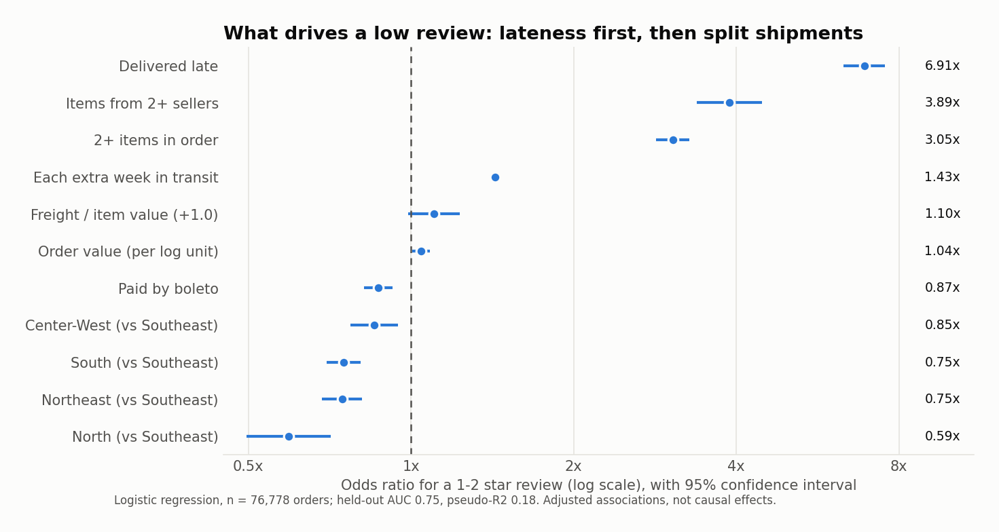
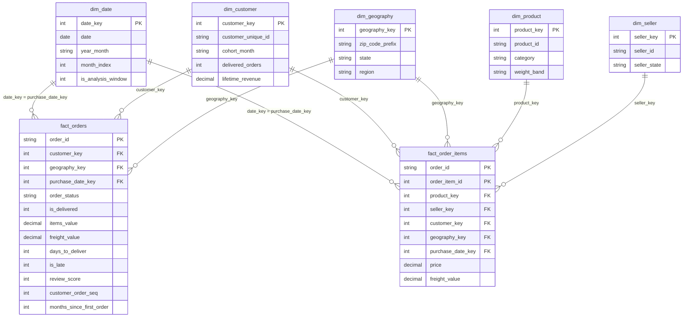

# Olist E-Commerce Analytics

End-to-end analysis of a Brazilian marketplace (about 100k orders, 2016-2018): a DuckDB
star schema, 13 SQL business analyses, two statistical tests, a formula-driven Excel
executive report, and a ready-to-build Power BI model with 38 validated DAX measures.

**The business question:** Olist grew quickly, but is that growth healthy? Where does the
revenue come from, do customers return, and what is damaging customer satisfaction?

**The answer in three lines** (details in [INSIGHTS.md](INSIGHTS.md)):

1. Growth is acquisition-only: 97% of customers never place a second order, and monthly
   revenue has been flat since the Nov-2017 peak.
2. Late delivery is the largest measurable driver of bad reviews: late orders score 2.27
   stars against 4.29 and are 6.7x as likely to get 1-2 stars.
3. The problem is concentrated: Rio de Janeiro alone is 22.9% of all late orders, and
   multi-seller orders have 3.9x the odds of a low review.

## Key results

All numbers come from `python run_all.py` on the real dataset.

| Metric | Value |
|---|---:|
| Orders placed / delivered | 99,441 / 96,478 (97.02%) |
| Revenue (item price, delivered orders) | R$ 13,221,498.11 |
| Average order value | R$ 137.04 |
| Customers (unique people) | 93,358 |
| Repeat customer rate | 3.00% (2,801 customers) |
| Late delivery rate | 6.77% (6,534 orders) |
| Average / median delivery time | 12.5 / 10 days |
| Average review score | 4.156 |
| Low reviews (1-2 stars) | 12.81% |
| Categories producing 80% of revenue | 18 of 74 |
| Revenue share of the top 5% of sellers | 53.1% |

| Statistical result | Estimate |
|---|---|
| Review score, on time vs late (Mann-Whitney U) | 4.29 vs 2.27; difference 2.02 (95% CI 1.98 to 2.06); p < 1e-300 |
| Effect size | probability of superiority 0.819; rank-biserial r = 0.64 |
| Low-review risk, late vs on time | 62.4% vs 9.3%; risk ratio 6.74 (95% CI 6.55 to 6.93) |
| Logistic regression, odds of a low review | late 6.91x; multi-seller 3.89x; multi-item 3.05x; each extra week 1.43x |
| Model fit (stated honestly) | held-out AUC 0.747; McFadden pseudo-R2 0.182 |



## What is in the repository

| Path | Contents |
|---|---|
| `run_all.py` | One command that rebuilds everything |
| `sql/model/` | Staging and star-schema DDL (3 files) |
| `sql/quality/` | 53 data-quality checks in one query |
| `sql/analysis/` | 13 business questions (CTEs, window functions, ROLLUP, QUALIFY) |
| `sql/validation/` | SQL re-computation of every DAX measure |
| `analysis/` | Two statistical analyses (Python, scipy, statsmodels) |
| `src/` | Pipeline steps: download, build, export, Excel, charts |
| `outputs/` | Generated: SQL results (CSV), data-quality report, statistics, charts |
| `reports/Olist_Executive_Report.xlsx` | Generated Excel report (7 sheets, 859 formulas, 9 charts) |
| `powerbi/` | CSV model, `measures.dax`, `EXPECTED_VALUES.md`, `theme.json`, `BUILD_GUIDE.md` |
| `tests/` | 47 pytest checks |
| `INSIGHTS.md` | Findings and recommendations for a business reader |

## Data model

Source: the [Olist Brazilian E-Commerce dataset](https://github.com/olist/work-at-olist-data)
(9 CSV files, published by Olist). It is loaded into DuckDB and reshaped into a star schema
with two fact tables that share conformed dimensions.



| Table | Grain | Rows | Key |
|---|---|---:|---|
| `fact_orders` | one order | 99,441 | `order_id` |
| `fact_order_items` | one order line | 112,650 | `(order_id, order_item_id)` |
| `dim_customer` | one person (`customer_unique_id`) | 96,096 | `customer_key` |
| `dim_product` | one product | 32,951 | `product_key` |
| `dim_seller` | one seller | 3,095 | `seller_key` |
| `dim_geography` | one 5-digit zip prefix (customer location) | 19,179 | `geography_key` |
| `dim_date` | one calendar day, 2016-2018 | 1,096 | `date_key` |

Modelling decisions worth knowing:

* **Customer key.** Olist issues a new `customer_id` for every order; the person is
  `customer_unique_id` (3,345 of 99,441 customer rows are repeat appearances). Using
  `customer_id` would make the repeat rate exactly zero.
* **Revenue** is item price on delivered orders. Both facts keep all order statuses, with an
  `is_delivered` flag, so fulfilment rate is still measurable.
* **Late** compares the delivery *date* with the promised *date*. Comparing timestamps would
  count an order delivered at 2 pm on the promised day as late.
* **One review per order**: 551 extra reviews were collapsed to the latest one per order.
* **Partial months** (2016, Sep/Oct-2018: 349 orders) stay in totals but are excluded from
  growth and cohort analysis through `dim_date.is_analysis_window`.

The full data-quality report (nulls, duplicates, orphan keys, date and value anomalies,
53 checks with real counts) is generated at `outputs/data_quality_report.md`.

## SQL analyses

| # | Question | Techniques |
|---|---|---|
| 00 | Headline KPIs | CTEs, LATERAL VALUES unpivot |
| 01 | Monthly revenue, MoM, YoY, rolling 3-month | `LAG`, named windows, frame clauses |
| 02 | Cohort retention matrix | `first_value`, conditional aggregation pivot |
| 03 | RFM segmentation | `NTILE`, rule-based scoring, CASE segmentation |
| 04 | Repeat-purchase rate and time to 2nd order | `LEAD`, `ROLLUP`, medians |
| 05 | Delivery time vs review score | banding, window totals |
| 06 | Late-delivery rate by state | `RANK`, share-of-total windows |
| 07 | Late-delivery rate by seller | two-level aggregation, `NTILE`, `HAVING` |
| 08 | Category contribution (Pareto / ABC) | running cumulative share |
| 09 | Payment-method mix | line-grain vs order-grain counting |
| 10 | Instalments vs order value | banding, `first_value` |
| 11 | Seller concentration | percentile tiers, HHI |
| 12 | Basket size | distribution and AOV by basket |

Run one file: `python src/run_sql_analysis.py 08_category` (results go to `outputs/sql/`).

## Excel report

`reports/Olist_Executive_Report.xlsx` is generated with openpyxl. Raw counts are values;
every ratio, share, growth rate and lookup is a live formula.

* **KPI Summary** - 14 KPIs computed by formula from the detail sheets, each compared with a
  SQL control total (`OK` / `CHECK`), plus month and state explorers driven by dropdowns
  (`XLOOKUP`, `INDEX`/`MATCH`, `SUMIFS`).
* **Monthly Trend** - AOV, MoM %, YoY %, rolling 3-month, cumulative; 3 charts.
* **Cohort Retention** - counts, retention % by formula, colour-scale heatmap, weighted curve.
* **RFM Segments**, **Category Pareto** (ABC class by formula), **Delivery & Reviews**.
* 37 named ranges, frozen panes, number formats, conditional formatting, data validation.

## Power BI

The finished report is `powerbi/Olist_Analytics.pbix` (open it in Power BI Desktop). It has
4 pages: Executive Overview, Customers & Retention, Delivery & Reviews, Products & Sellers.

It was built by hand from `powerbi/BUILD_GUIDE.md`: import 7 CSVs, create 8 relationships,
load `measures.dax`, build the pages. The page grid, theme (`powerbi/theme.json`) and table
formatting were then applied with the scripts in `powerbi/` (`restructure_report.py`,
`style_report.py`, `fix_seller_table.py`), which edit the report definition inside the file.
`powerbi/EXPECTED_VALUES.md` lists 56 SQL-computed values to check the measures against.

## Reproduce

```bash
pip install -r requirements.txt
python run_all.py
```

Requires Python 3.11+ and an internet connection for the first run (about 120 MB of CSVs
from GitHub). The full pipeline takes about two minutes and ends by running the tests.
Row counts are verified after download:

| File | Rows |
|---|---:|
| olist_orders_dataset.csv | 99,441 |
| olist_order_items_dataset.csv | 112,650 |
| olist_order_payments_dataset.csv | 103,886 |
| olist_order_reviews_dataset.csv | 99,224 |
| olist_customers_dataset.csv | 99,441 |
| olist_sellers_dataset.csv | 3,095 |
| olist_products_dataset.csv | 32,951 |
| olist_geolocation_dataset.csv | 1,000,163 |
| product_category_name_translation.csv | 71 |

Tests only: `python -m pytest -q` (47 tests: key uniqueness, orphan facts, KPI
reconciliation between warehouse, SQL outputs, Excel and Power BI expected values, cohort
matrix sanity).

## Limitations

* **Old, single-market data** (Brazil, 2016-2018). Findings describe that period.
* **Revenue, not profit.** No costs, commissions, refunds or marketing spend.
* **Observational.** The statistics show associations. The regression explains a modest
  share of low reviews (pseudo-R2 0.18); product quality and seller behaviour are not observed.
* **Reviews are voluntary** (768 orders have none) and one per order, even when an order
  ships in several parcels.
* **Short horizon for retention.** The latest cohorts have only a few months of history.
* **RFM frequency is scored by rule**, not quintile, because 97% of customers have one order.
* **Geography** uses zip-prefix centroids; 169 of 19,179 prefixes have no coordinates.
* **DAX measures are validated by SQL re-computation.** In the report, the headline cards
  (revenue, orders, AOV, repeat rate, late delivery %, review score) match those values; the
  remaining measures have not each been checked against `EXPECTED_VALUES.md` in Power BI.
* **Excel formulas** have no cached values until the file is opened in Excel (it
  recalculates on open); tests re-evaluate the KPI formulas in Python instead.
